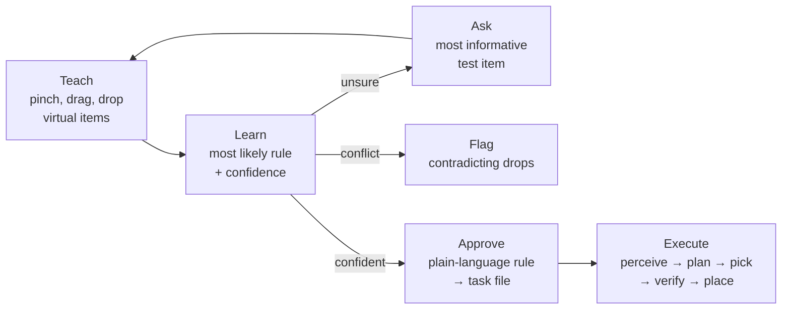
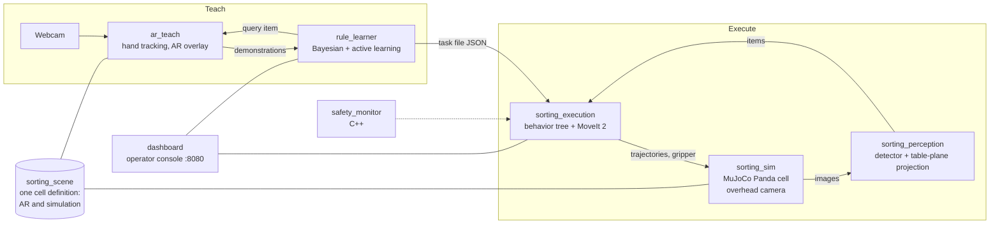
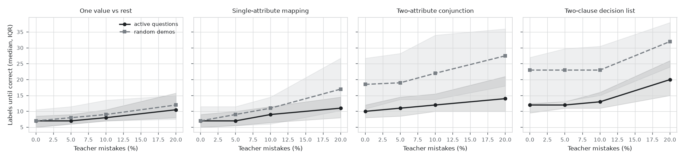
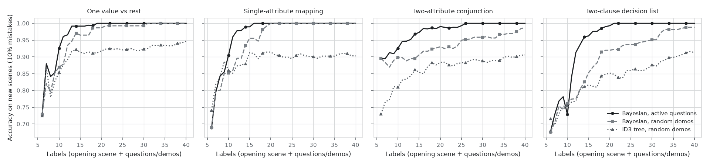
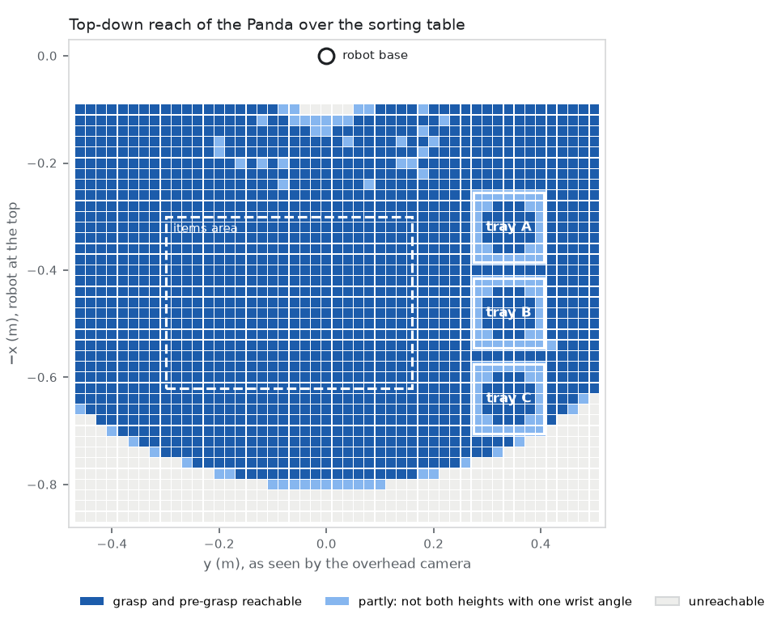

# Teach-by-Demonstration Sorting Robot

**Show a robot how to sort with your hand. It learns the rule, asks when it isn't sure, and sorts new items on its own.**

ROS 2 · MoveIt 2 · MuJoCo · MediaPipe · PyTorch · Behavior trees · C++

> **Preview.** This is the planned final README, kept so the finished project can be judged before it exists. Numbers in **bold black** are measured today. Numbers marked *target* are goals, to be replaced by measurements (milestones M4–M8). Missing media are marked as placeholders.

---

<!-- Demo: 60-90 s video, recorded in M8 (script in docs/demo_script.md) -->
**[ Demo video placeholder: teach 6 items by hand → the system asks one question → rule approved → the robot sorts a new scene, I will add this later ]**

| Teach (webcam + AR) | Learned rule | Robot execution (simulation) |
|---|---|---|
| *screenshot placeholder:* pinching a virtual red cube into box A | *screenshot placeholder:* "Sort by color: red to A, blue to B, others to C", 99.5% | *screenshot placeholder:* Panda dropping an item into tray B |

## The idea
Sorting machines in food and recycling plants are re-configured by engineers who edit rules and thresholds. This project explores a faster way: **a line worker teaches the rule by demonstration.**

1. On a live webcam view, the worker picks up virtual items with a pinch and drops them into boxes.
2. The system learns **the sorting rule, not the hand motion** (for example "large items to reject, everything else to accept").
3. When the examples fit more than one rule, it creates the most informative test item and asks the worker to sort it. It points out contradictory examples, and shows the final rule as one plain sentence to approve.
4. The approved rule is saved as a robot-independent task file.
5. A simulated Franka Panda then sorts new, randomly arranged scenes. It uses its own camera and a trained detector, and plans every grasp and motion itself.

## Key results
**Rule learning:** a simulated teacher, 25 hidden rules per type. Each session starts with one 6–10-item scene.

| Hidden rule | Teacher mistakes | Examples until the rule is right: **active** vs random | Correct when the system stops: **active** vs random |
|---|---|---|---|
| Two-attribute conjunction ("large red to C, else A") | 0% | **10** vs 18.5 | **100%** vs 76% |
| Two-attribute conjunction | 10% | **12** vs 22 | **96%** vs 64% |
| Two-clause decision list ("red to A; otherwise large to B; else C") | 10% | **13** vs 23 | **100%** vs 56% |

**Robot execution:** simulation, random scenes, rule "sort by color".

| Metric | Ground-truth positions (upper bound, measured) | Full system: own camera + detector + behavior tree |
|---|---|---|
| Scenes / items | **20 / 176** | 200+ / ~1,800 *target* |
| Pick success | **98.9%** | ≥ 95% *target* |
| Items in the correct tray | **98.9%** (174/176) | ≥ 93% *target* |
| Planning failures on feasible items | **0** | < 1% *target* |
| Recovered after a failed grasp | n/a | ≥ 80% *target* |
| Throughput (simulation time) | **4.3** items/min | *placeholder* items/min |

**Perception:** synthetic images, domain randomization.

| Metric | With domain randomization | Without (ablation) |
|---|---|---|
| Color / size / shape accuracy | *target* ≥ 98% / 95% / 97% | *placeholder* |
| Position error on the table (median) | *target* ≤ 5 mm | *placeholder* |

**End to end:** taught with real hand demonstrations, then executed. *Placeholder:* rules taught, teaching time per rule, grab/release detection reliability, sorting accuracy.

## How it works


- **Teach.** MediaPipe tracks the hand. The pinch is detected from the thumb–index distance with hysteresis and smoothing, so grabs don't flicker. Losing the hand mid-drag returns the item to where it was.
- **Learn.** Bayesian concept learning over about 1,300 interpretable rules, with a preference for simpler rules. It tolerates occasional teaching mistakes and reports the competing rules, not just the winner.
- **Ask.** It picks the item whose label would remove the most uncertainty (expected information gain). This roughly halves the examples needed for compound rules.
- **Approve.** The rule, its evidence and the closest alternatives are shown in one sentence. The approved rule is saved as a JSON task file with a published schema.
- **Execute.** A behavior tree drives the cell: perceive → classify → apply rule → plan the whole pick-and-place → pick → verify grasp → place → next. Recovery branches re-perceive, retry the grasp, or skip and report. Unreachable items are reported, never attempted. A C++ safety monitor enforces the emergency stop, workspace bounds, speed limits and heartbeats.

## Architecture

- **One scene definition** is shared by the AR view and the simulator, so what the worker teaches and what the robot sees are digital twins.
- **Only the goal crosses from teaching to execution** (item → box), never the hand trajectory. This sidesteps the human-vs-robot body mismatch.
- **Same interfaces as a real robot.** The simulator serves the same ROS controller interfaces as a ros2_control Panda: a joint trajectory action, a gripper action, joint states and a clock. A contract test checks that MoveIt drives it, so a real arm can be swapped in.

## Operator dashboard
*Screenshot placeholder:* an industrial-HMI style console with four modes:
- **Teach:** live AR feed, demonstrations so far, the current question.
- **Rule:** the rule sentence, its confidence, the evidence and competing rules.
- **Run:** camera with detections, behavior tree step, per-item results.
- **Results:** benchmark plots.

## Tech stack
| Part | Choice |
|---|---|
| Middleware | ROS 2 Lyrical on Ubuntu 26.04 |
| Hand tracking | MediaPipe HandLandmarker + OpenCV |
| Rule learning | Bayesian concept learning with a simplicity prior; ID3 decision tree as baseline |
| Simulation | MuJoCo 3.12 with the Menagerie Franka Panda |
| Motion planning | MoveIt 2 (Pilz PTP/LIN, OMPL fallback) |
| Perception | PyTorch detector trained only on auto-labelled synthetic images *(M4)* |
| Execution | Behavior tree with recovery branches *(M5)* |
| Safety | C++ node: e-stop, bounds, speed limits, watchdogs *(M5)* |
| Dashboard | FastAPI + WebSockets, a single page *(M6)* |
| Quality | pytest, ruff, mypy, GitHub Actions CI, Docker *(M8)* |

## Quick start
```bash
# Docker (recommended; M8)
docker compose up                       # simulator, perception, execution, dashboard
open http://localhost:8080              # operator console

# Or natively (Ubuntu 26.04, ROS 2 Lyrical): see "Setup" in docs/technical_report.md
source env_setup.sh
ros2 launch sorting_bringup teach.launch.py                     # webcam teaching
ros2 launch sorting_bringup teach.launch.py source:=synthetic   # no webcam: a scripted hand teaches
ros2 launch sorting_bringup execute.launch.py task:=tasks/by_color.json   # robot sorts a saved rule
ros2 launch sorting_bringup full.launch.py                      # teach, approve, execute
ros2 launch sorting_bringup benchmark.launch.py scenes:=200     # headless evaluation, CSV + plots
```

## Evaluation
All results are reproducible from scripts. Each run writes CSVs, plots and summary tables; representative runs and failures are also recorded as rosbags.
- **Rule learning:** a simulated teacher with a hidden rule answers the questions, sometimes making mistakes on purpose. Active questions are compared with random examples on the same opening scene (common random numbers), with an ID3 baseline and ablations.
- **Perception:** per-attribute accuracy, confusion matrices, detection mAP and position error. The detector is trained with and without domain randomization (lighting, textures, colour shifts, camera noise).
- **Execution:** 200+ random scenes. Pick success, place success, sorting accuracy, cycle time, planning-failure rate and recovery success, with infeasible items reported separately.
- **Failure analysis:** failures are grouped into categories; at least one fix is implemented and measured before and after.





*Placeholders:* perception confusion matrix · domain-randomization ablation · execution results over 200 scenes · failure categories before/after the fix.

## Repository layout
```
sorting_ws/src/
  sorting_scene/       shared cell definition, seeded random scenes
  ar_teach/            webcam AR teaching (MediaPipe)
  rule_learner/        Bayesian rule learning, active learning, benchmark
  sorting_task/        task-file schema and plain-language rules
  sorting_sim/         MuJoCo cell behind ros2_control-style interfaces
  sorting_perception/  synthetic data, detector, table-plane projection     (M4)
  sorting_motion/      grasp planning, MoveIt chain planning, reachability
  sorting_execution/   behavior tree, recovery, cell states                 (M5)
  safety_monitor/      C++ e-stop, limits, watchdogs                        (M5)
  dashboard/           operator console                                     (M6)
  sorting_bringup/     launch files: teach / execute / full / benchmark
docs/                  technical report, task-file schema, figures, decisions
```

## Limitations
- Simulation only; no real arm was used.
- Pick-and-place of rigid items. Force-sensitive handling, deformable items and conveyors are out of scope.
- Rules are combinations of colour, size and shape. Learning new attributes, or continuous thresholds, is future work.
- The simulated gripper is softer than a real Franka hand, and contact physics in simulation occasionally misbehaves. Both are documented in the failure analysis.

## Future work: path to a real robot
- **Arm:** swap the simulator for a real Panda driver, or for `mujoco_ros2_control`. The controller interface is the same, and the contract test checks any backend.
- **Camera:** calibrate a real overhead camera (intrinsics plus a hand–eye or table calibration), then fine-tune the detector on a small set of real images.
- **Safety:** add an external safety PLC and certified e-stop; the C++ monitor stays a software layer only.
- **Teaching:** allow real objects as the taught items, not only virtual ones.

## Documentation
- [docs/technical_report.md](docs/technical_report.md): short R&D-style report *(M8)*.
- [DECISIONS.md](DECISIONS.md): every design decision with evidence and how to reverse it.
- [docs/task_file_schema.json](docs/task_file_schema.json): the task-file format.

## Acknowledgements
- [MuJoCo Menagerie](https://github.com/google-deepmind/mujoco_menagerie) Franka Panda model (Apache-2.0).
- MoveIt 2 and `moveit_resources_panda`.
- MediaPipe.
- Barlow fonts (SIL OFL).
